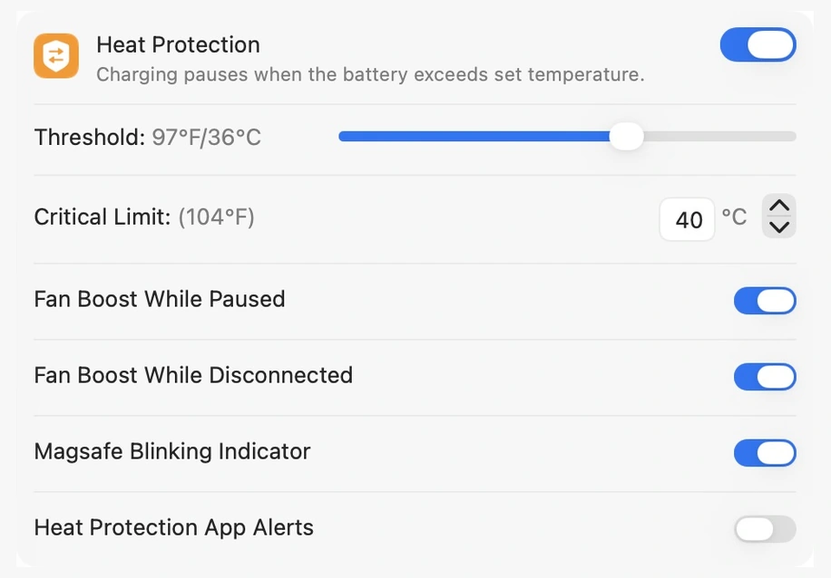
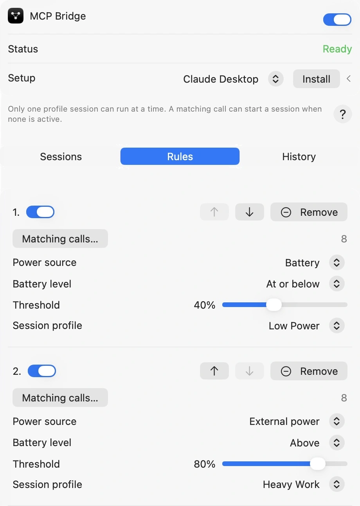
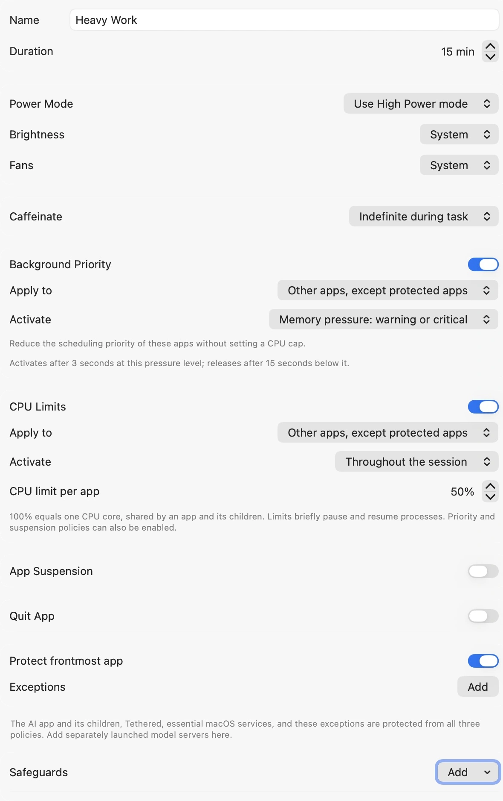
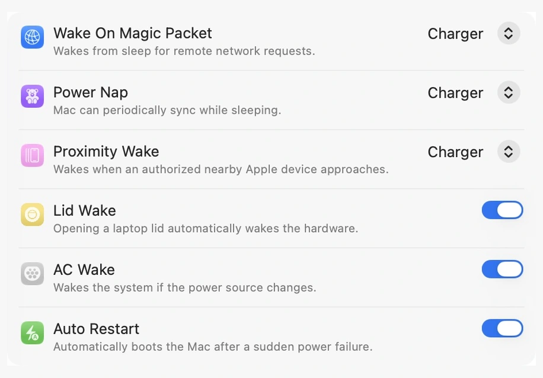
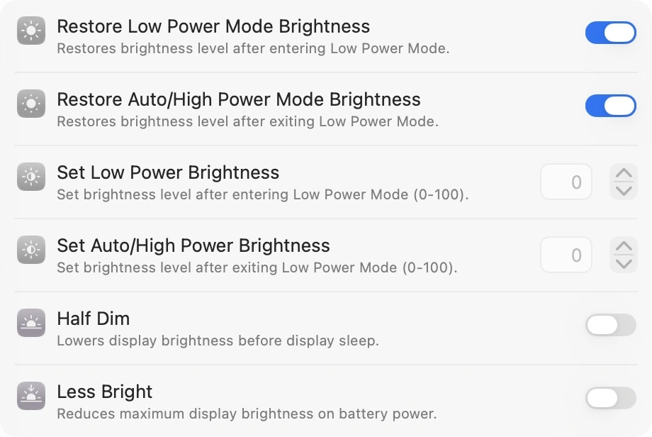
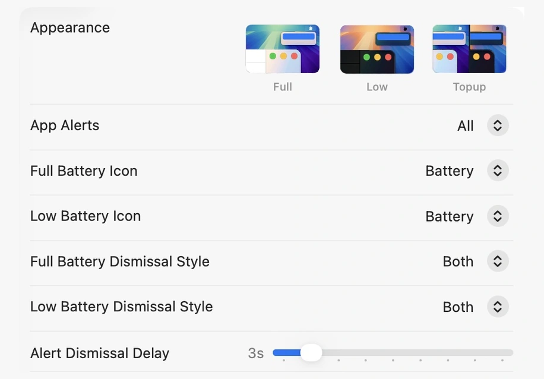
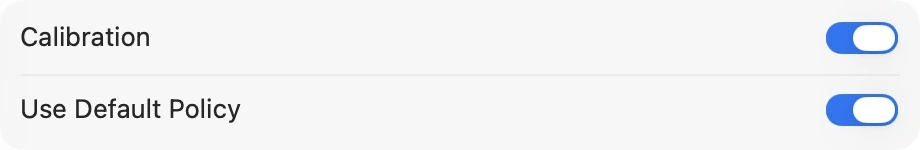
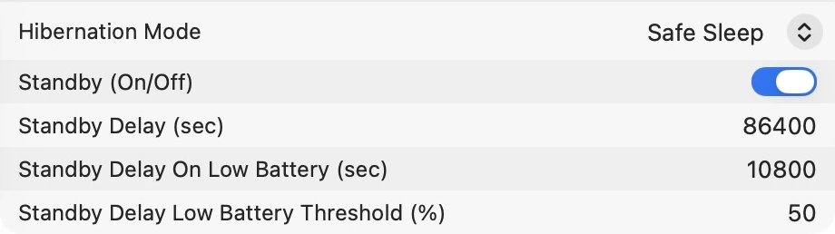
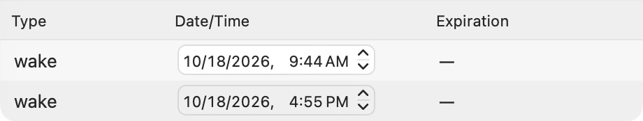
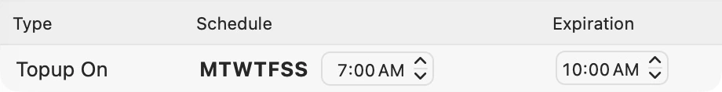

<picture>
  <source media="(prefers-color-scheme: dark)" srcset="SocialPreviewDark.png">
  <source media="(prefers-color-scheme: light)" srcset="SocialPreview.png">
  
</picture>

# Tethered

Tethered is a macOS app for managing battery charging, power behavior, and automation. It brings charging controls, battery history, scheduled routines, and task-aware power management into one place, with quick access from the menu bar. Configure everyday routines or apply temporary resource profiles while local AI tools work.

**All New Accounts Get a 7-Day Free Trial.**

<a href="https://github.com/Tumerit/homebrew-tap"> Install with Homebrew</a>

```sh
brew install --cask Tumerit/tap/tethered
```

<a href="https://github.com/Tumerit/Tethered/raw/refs/heads/main/Alfred/Tethered.alfredworkflow"> Alfred Workflow</a> — Version 1.1.2 includes event-response and daylight-saving fixes, plus scheduled and repeating event management, live Quick Event previews, and MCP/Companion bridge commands. Requires Alfred 5 with Powerpack and an updated Tethered app installed and running. See the [workflow guide](Alfred/README.md) for compatibility and current validation limits.

## What you can do

- **Control power modes:** Set persistent High or Low Power behavior, configure automatic power-mode thresholds, and switch modes from the menu bar.
- **Manage sleep and wake:** Use Caffeinate presets to keep the Mac or display awake, configure macOS wake and restart assertions, and adjust standby, hibernation mode, and delays.
- **Automate by app:** Set schedules and apply power, Caffeinate, brightness, and supported fan actions when selected apps launch, activate, deactivate, or quit.
- **Schedule system actions:** Create one-time or repeating events for power modes, Top-up, Caffeinate, brightness, wake, sleep, power on, and shutdown.
- **Protect charging and thermals:** Set a charging limit, use Sailing to let the battery discharge before charging resumes, run Top-up when needed, and pause charging when the battery gets too warm. Supported Macs can boost fans while charging is paused.
- **Run AI task sessions:** Apply saved task profiles to local AI work with temporary power and Caffeinate settings, background-process priority, per-app CPU limits, suspension, memory-pressure triggers, and task safeguards. Match agent calls to profiles using power-source and battery-level rules.
- **Save, share, and sync profiles:** Keep named settings snapshots, export or import profiles, and sync or back up settings and assets through iCloud with Pro Access.
- **Calibrate your battery:** Start a cycle manually or schedule one under a calibration policy.
- **Adjust the display:** Restore or set brightness when power modes change, and configure dimming before display sleep.
- **Customize the menu bar:** Change its background, control colors, slider appearance, and icons while previewing the result.
- **Track battery condition:** Review battery health, cycle count, charge level, and temperature history; export battery history as CSV or JSON and export app logs.
- **Manage alerts:** Customize battery notifications and sounds, and manually or automatically dismiss the persistent macOS low-battery banner.
- **Use shortcuts and Siri:** Trigger supported charging and power actions through Apple Shortcuts, Siri, and keyboard shortcuts.

## Pro Access

Pro Access is **$9.99 per device**. Pay once, lifetime upgrades. It unlocks extended charging controls and heat protection options, power mode thresholds and system controls, app-based automation, Caffeinate presets, additional keyboard shortcuts and Apple Shortcuts actions, iCloud settings sync, and more alert customization. You can purchase or check access for this Mac in Tethered's Pro Access settings.

## Your data

Tethered keeps your settings and battery history locally on your Mac. With Pro Access, you can enable iCloud sync for your settings and assets, or back up and restore them through your iCloud account. Battery history remains available locally in Tethered's Application Support folder.

You can manage settings in the app, view battery health and charge history in **Stats**, and export battery health history as **CSV or JSON**. Tethered also lets you export its logs. Open **Account → iCloud** to find the local data location and iCloud backup controls.

## AI Integrations Preview

**Use the latest Tethered release, installed and running on the same Mac and user account, with Pro Access and MCP Bridge enabled in Tasks.** Older integrations require Tethered 1.2.0 or later; available controls depend on your installed version.

Connect a local AI assistant to Tethered while it runs builds, test suites, data-processing jobs, and other work on your Mac. A saved task profile can:

- Request Automatic, Low Power, or High Power mode where supported
- Set brightness and supported fan behavior
- Keep your Mac awake with Caffeinate
- Limit CPU usage for eligible background apps
- Deprioritize or temporarily suspend eligible background apps
- Suspend eligible apps at configured memory-pressure levels, with exceptions and frontmost-app protection

Open **Tasks → Sessions** to create a profile. In **Rules**, assign matching agent calls and choose power-source and battery-level conditions. For example, use a Low Power profile on battery at or below 40%, and a Heavy Work profile on external power above 80%. **History** lists unassigned calls that you can add to a rule. Only one profile session can run at a time.

Task safeguards can flag repeated failures, calls, or output; matching output; inactivity; missing progress reports; task runtime; and sustained memory pressure. A safeguard can notify you or request that the AI client pause or cancel work. Those requests depend on the client cooperating; Tethered does not directly pause or cancel the AI task. Ending or expiring a session releases temporary controls and resumes apps Tethered suspended. Heat monitoring, alerts, and configured fan protection remain active.

For Claude Desktop, download [tethered-0.2.7.mcpb](https://github.com/Tumerit/Tethered/releases/download/v1.2.3/tethered-0.2.7.mcpb). The MCPB launches the adapter from the installed app; it does not install Tethered.

For Codex, Claude Code, Cursor, Gemini CLI, VS Code/Copilot, and other supported local clients, see [plugin installation and manual setup](Integrations/README.md).

See the dated [integration validation record](Integrations/VALIDATION.md) for tested clients and remaining limitations.

## Screenshots

Captured October 18, 2026. Click an image to view it at full size.

| Heat protection | Battery history |
| --- | --- |
|  |  |

| Task activation rules | Task resource profile |
| --- | --- |
|  |  |

| Per-app automation | System assertions |
| --- | --- |
|  |  |

| Display brightness | Battery alerts |
| --- | --- |
|  |  |

<details>
<summary>Calibration, standby, and scheduled events</summary>

| Calibration | Standby |
| --- | --- |
|  |  |

| Scheduled events | Repeating events |
| --- | --- |
|  |  |

</details>

<details>
<summary>Menu customization and Caffeinate presets (October 14, 2026)</summary>

| Menu appearance customization | Caffeinate presets |
| --- | --- |
|  |  |

</details>

## Get Tethered

Download the macOS installer from [GitHub Releases](https://github.com/Tumerit/Tethered/releases). The `.pkg` file is for manual installation; the `.Sparkle.zip` file is used by the app's built-in updater.
