<picture>
  <source media="(prefers-color-scheme: dark)" srcset="SocialPreviewDark.png">
  <source media="(prefers-color-scheme: light)" srcset="SocialPreview.png">
  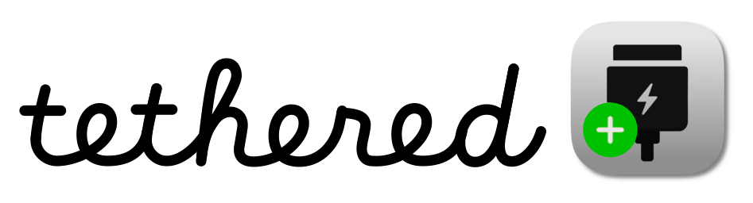
</picture>

# Tethered


[](https://mcprush.com/to/tethered-task-sessions-mcp?ref=badge)

Tethered is a macOS app for managing battery charging, power behavior, and automation. It brings charging controls, battery history, scheduled routines, and task-aware power management into one place, with quick access from the menu bar. Configure everyday routines or apply temporary resource profiles while local AI tools work.

[View screenshots](#screenshots)

**All New Accounts Get a 7-Day Free Trial.**

<a href="https://github.com/Tumerit-LLC/homebrew-tap"> Install with Homebrew</a>

```sh
brew install --cask Tumerit-LLC/tap/tethered
```

<a href="https://github.com/Tumerit-LLC/Tethered/raw/refs/heads/main/Alfred/Tethered.alfredworkflow"> Alfred Workflow</a> — Version 1.1.2 includes event-response and daylight-saving fixes, plus scheduled and repeating event management, live Quick Event previews, and MCP/Companion bridge commands. Requires Alfred 5 with Powerpack and an updated Tethered app installed and running. See the [workflow guide](Alfred/README.md) for compatibility and current validation limits.

## What you can do

- **Control power modes:** Set persistent High or Low Power behavior, configure automatic power-mode thresholds, and switch modes from the menu bar.
- **Manage sleep and wake:** Use Caffeinate presets to keep the Mac or display awake, configure macOS wake and restart assertions, and adjust standby, hibernation mode, and delays.
- **Automate by app:** Set schedules and apply power, Caffeinate, brightness, and supported fan actions when selected apps launch, activate, deactivate, or quit.
- **Schedule system actions:** Create one-time or repeating events for power modes, Top-up, Caffeinate, brightness, supported fan actions, wake, sleep, power on, and shutdown. Edit dates, weekdays, times, action durations, and expiration settings directly in the event tables.
- **Make automation battery-aware:** Add power-source and battery-level conditions to task profiles, app rules, and scheduled events. Threshold handling helps prevent repeated switching near a boundary.
- **Protect charging and thermals:** Set a charging limit, use Sailing to let the battery discharge before charging resumes, run Top-up when needed, and pause charging when the battery gets too warm. Supported Macs can boost fans while charging is paused.
- **Run AI task sessions:** Apply saved task profiles to local AI work with temporary power and Caffeinate settings, background-process priority, per-app CPU limits, suspension, app quitting, memory-pressure triggers, and task safeguards. Configure each resource policy’s targets and triggers separately, with app exceptions and optional protection for the frontmost app and AI processes.
- **Save, share, and sync profiles:** Keep named settings snapshots and export them as `.tetheredprofile` files. Review an imported profile before choosing Add or Add & Apply. Transfers and backups include task profiles, activation rules, bridge settings, shortcuts, and menu appearance; iCloud sync and backup are available with Pro Access.
- **Calibrate your battery:** Start a cycle manually or schedule one under a calibration policy.
- **Adjust the display:** Restore or set brightness when power modes change, and configure dimming before display sleep.
- **Customize the menu bar:** Change its background, control colors, slider appearance, and icons while previewing the result. Import transparent PNG backgrounds and custom control artwork, adjust their opacity, and save the appearance in a settings profile.
- **Track battery condition:** Review battery health, cycle count, charge level, and temperature history; export battery history as CSV or JSON and export app logs.
- **Manage alerts:** Customize battery notifications and sounds, and manually or automatically dismiss the persistent macOS low-battery banner.
- **Control Tethered from launchers:** Use Alfred or Raycast to manage scheduled and repeating events, including editing, deletion, and repeat toggles. Create Quick Events from typed phrases and review their previews. Raycast also exposes MCP Bridge controls and the next upcoming event.
- **Use shortcuts and Siri:** Trigger supported charging and power actions through Apple Shortcuts, Siri, and keyboard shortcuts.

## Pro Access

Pro Access is **$9.99 per device**. Pay once, lifetime upgrades. It unlocks extended charging controls and heat protection options, power mode thresholds and system controls, app-based automation, Caffeinate presets, additional keyboard shortcuts and Apple Shortcuts actions, iCloud settings sync, and more alert customization. You can purchase or check access for this Mac in Tethered's Pro Access settings.

## Your data

Tethered keeps your settings and battery history locally on your Mac. With Pro Access, you can enable iCloud sync for your settings and assets, or back up and restore them through your iCloud account. Battery history remains available locally in Tethered's Application Support folder.

You can manage settings in the app, view battery health and charge history in **Stats**, and export battery health history as **CSV or JSON**. Tethered also lets you export its logs. Open **Account → iCloud** to find the local data location and iCloud backup controls.

## AI Integrations Preview

**Use the latest Tethered release, installed and running on the same Mac and user account, with Pro Access and MCP Bridge enabled in Tasks.** Older integrations require Tethered 1.2.0 or later; available controls depend on your installed version.

Connect a local AI assistant to Tethered while it runs builds, test suites, data-processing jobs, and other work on your Mac. A saved task profile can:

- Request Automatic, Low Power, or High Power mode where supported
- Set brightness and supported fan behavior
- Keep your Mac awake with Caffeinate
- Limit CPU usage for eligible background apps
- Independently deprioritize, temporarily suspend, or quit selected eligible apps
- Suspend eligible apps at configured memory-pressure levels, with exceptions and frontmost-app protection

Open **Tasks → Sessions** to create a profile. Set power-source and battery-level conditions in the profile editor, then assign matching agent calls in **Rules**. For example, use a Low Power profile on battery at or below 40%, and a Heavy Work profile on external power above 80%. **Rules** supports Exact and Starts With matching for tool calls and shell commands. **History** lists unassigned calls that you can add to a rule. Only one profile session can run at a time.

Native lifecycle hooks for Codex, Claude Code, Cursor, and Gemini CLI can activate and release task profiles as local work starts and ends. Install the integration for your client and configure matching calls in Tasks; other supported clients use the MCP setup described below.

Task safeguards can flag repeated failures, calls, or output; matching output; inactivity; missing progress reports; task runtime; and sustained memory pressure. A safeguard can notify you or request that the AI client pause or cancel work. Those requests depend on the client cooperating; Tethered does not directly pause or cancel the AI task. Ending or expiring a session releases temporary controls and resumes apps Tethered suspended. Heat monitoring, alerts, and configured fan protection remain active.

For Claude Desktop, download [tethered-0.2.7.mcpb](https://github.com/Tumerit-LLC/Tethered/releases/download/v1.2.3/tethered-0.2.7.mcpb). The MCPB launches the adapter from the installed app; it does not install Tethered.

For Codex, Claude Code, Cursor, Gemini CLI, VS Code/Copilot, and other supported local clients, see [plugin installation and manual setup](Integrations/README.md).

See the dated [integration validation record](Integrations/VALIDATION.md) for tested clients and remaining limitations.

## Screenshots

Full-height settings captures from October 19, 2026. Scrollable views are assembled from overlapping native screenshots, with the sidebar omitted so the complete settings remain readable. Click an image to view it at full size.

| Battery: charging, heat protection, and menu controls | Control Center: power modes, assertions, and Caffeinate |
| --- | --- |
| 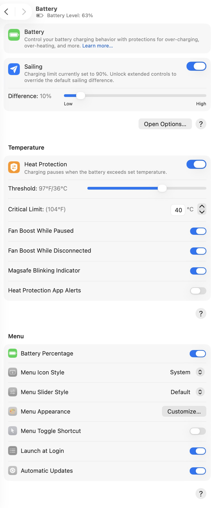 | 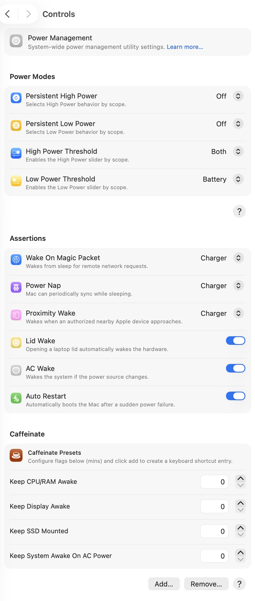 |

| Battery history | Per-app automation |
| --- | --- |
| 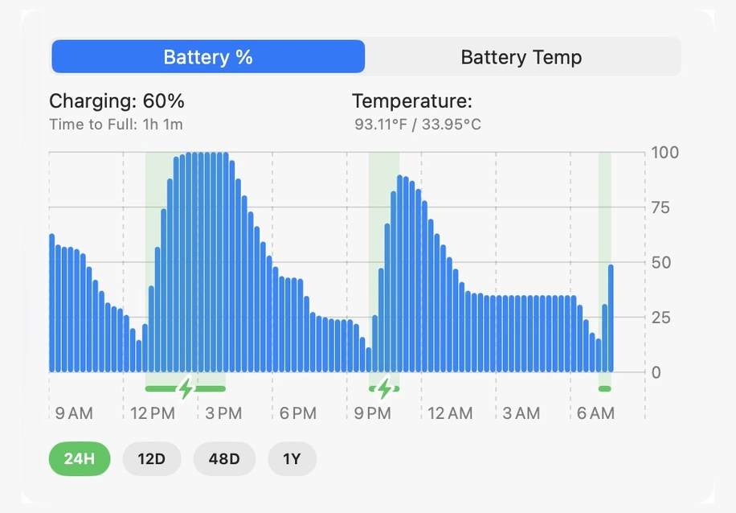 | 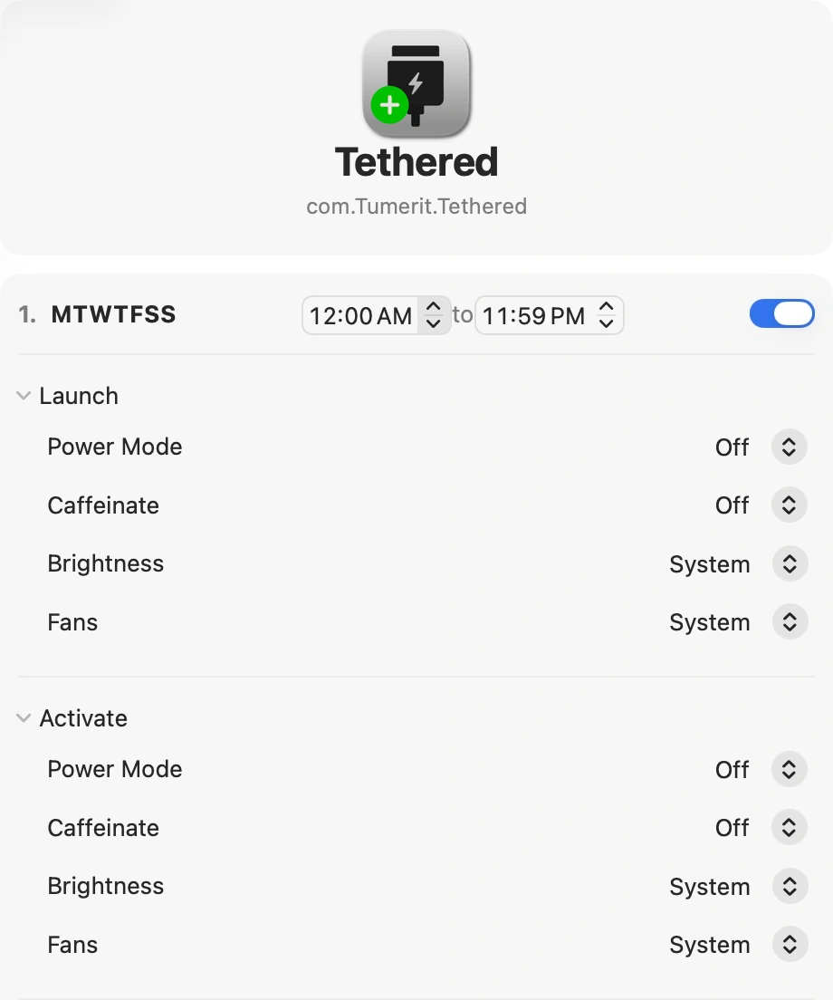 |

| General: Siri, extensions, and keyboard shortcuts | Profile: saved settings, calibration, standby, and events |
| --- | --- |
| 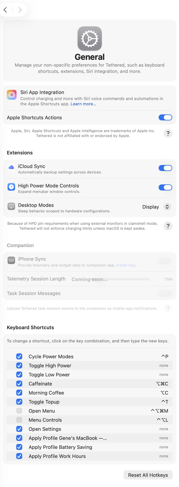 | 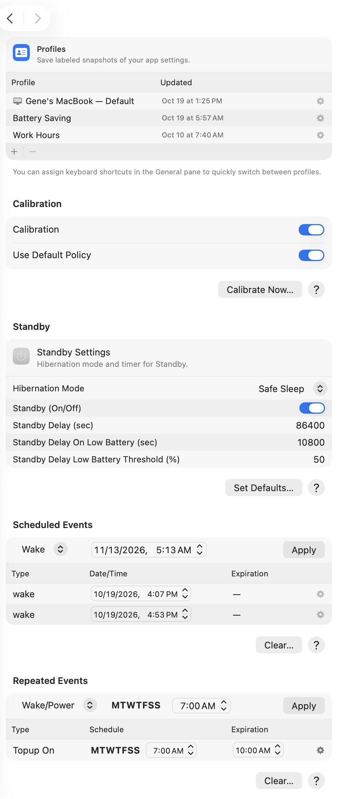 |

| Display: all brightness controls | Appearance: alerts, sounds, and dismissal behavior |
| --- | --- |
| 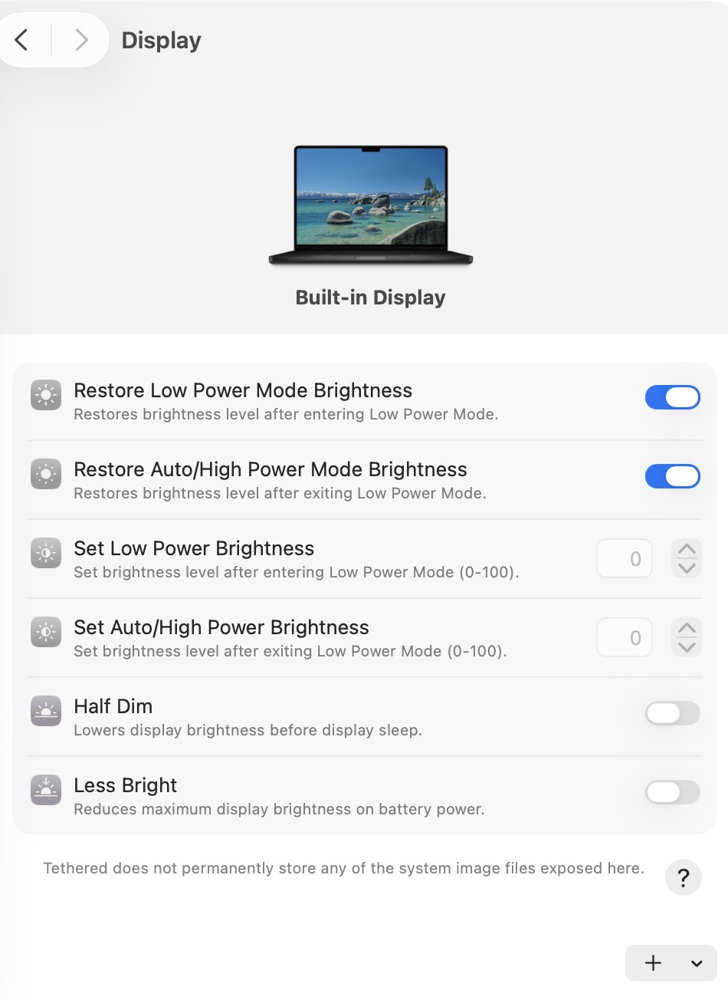 | 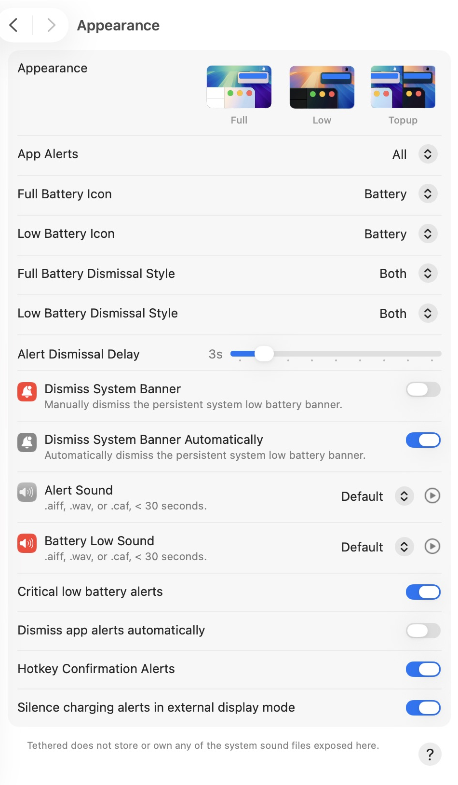 |

| Tasks: sessions and saved profiles | Complete task profile editor |
| --- | --- |
| 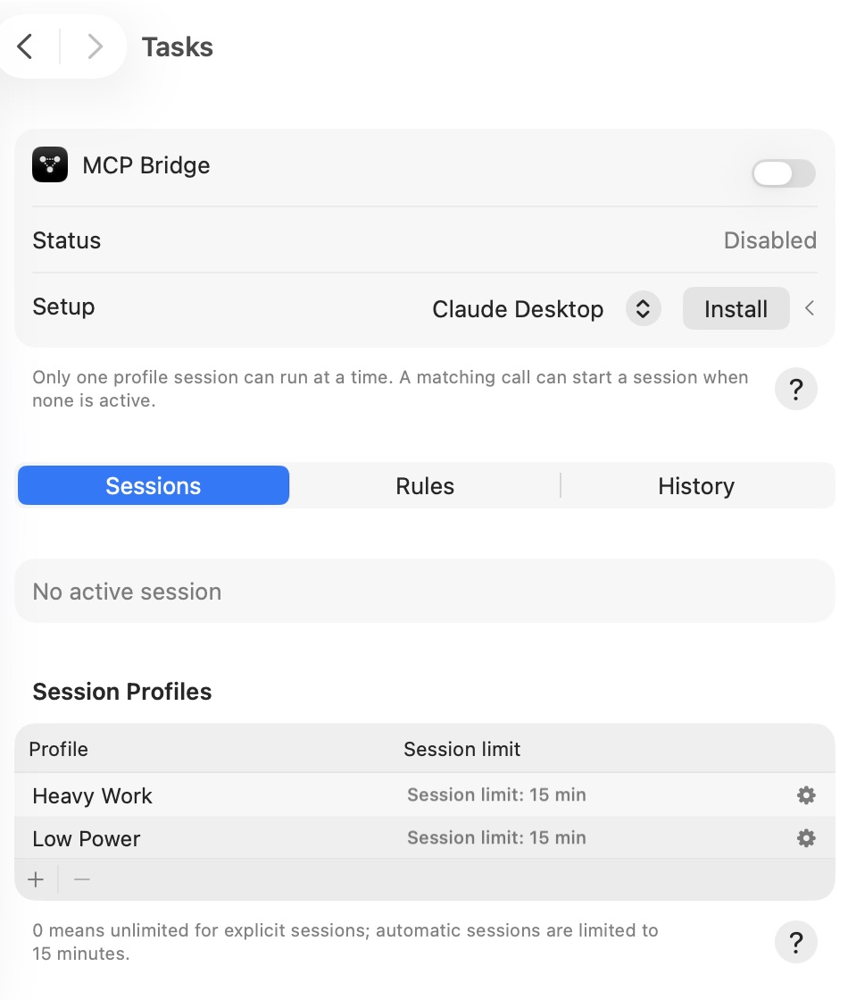 | 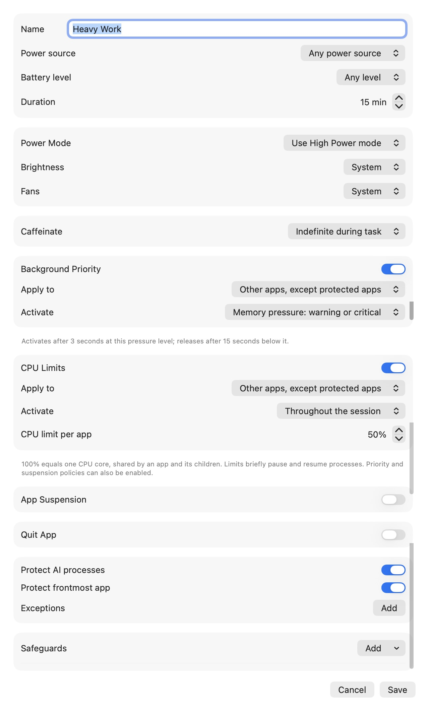 |

### Menu appearance customization


## Get Tethered

[Download Tethered for macOS](https://www.tetheredmac.com/download). Extract the downloaded `Tethered-VERSION.zip`, then open the enclosed DMG and follow the installation instructions. The separate `.Sparkle.zip` archive is used by the app's built-in updater.

## License and security

This repository is proprietary. See the [license](LICENSE) for terms and the
[security policy](SECURITY.md) for private vulnerability reporting.
